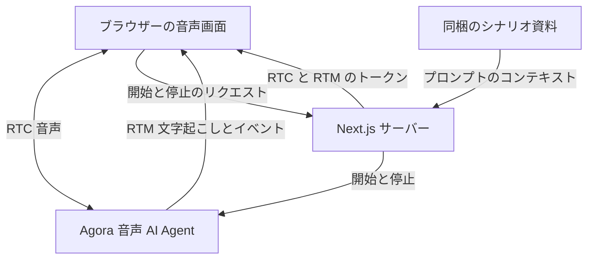

# Agora 多言語スピーキングコーチ デモ

[English](README.md) | [简体中文](README.zh-CN.md) | [日本語](README.ja.md)

この文書のみ翻訳しています。画面は英語です。スペイン語、フランス語、ドイツ語、ポルトガル語、日本語、韓国語を選択でき、説明は英語です。

英語の説明とフィードバックで、選択した言語で自己紹介・注文・職場会話を練習します。

**[デモを試す →](https://agora-speaking-coach-demo.vercel.app)**

**[Explore more voice AI demos on Agora Recipes →](https://recipes.agora.io/)**

[](https://www.agora.io/en/products/conversational-ai-engine/)
[](https://nextjs.org/docs)
[](LICENSE)

[機能](#features) · [技術構成](#tech-stack) · [ローカル実行](#run-locally) · [Vercel へのデプロイ](#deploy-to-vercel) · [使い方](#how-it-works) · [カスタマイズ](#customize) · [よくある質問](#faq) · [関連リンク](#more)

<a id="what-you-can-do"></a>
<a id="features"></a>

## 機能

- 言語と初級カリキュラムのレッスン（自己紹介・職場での会話・食事の注文・会計）を選びます。
- レッスンの can-do 目標に向けて、英語の説明で練習します。コーチには選択したレッスンの内容だけが渡されます。
- Phrasebook はレッスンの語彙・用法のポイント・モデル会話を表示します。日本語と韓国語にはローマ字の読みが付きます。
- 文字起こしに基づく語彙・文法の助言を受けます。
- セッション終了後に練習サマリーを確認し、レッスンを完了にできます。
- 前回の続きから再開できます。練習履歴はアカウントなしで保存され、端末を切り替えるための学習コードがあります。

レッスンの目標は、欧州評議会の[ヨーロッパ言語共通参照枠 (CEFR)](https://www.coe.int/en/web/common-european-framework-reference-languages) の A1 レベルの書き方にならって独自に作成した can-do 記述です。この枠組みはレッスンの構成にのみ使用し、コーチが学習者のレベルを評価・認定することはありません。
- 文字起こしに基づく語彙・文法の助言です。発音採点はありません。

## 技術構成

- **フロントエンド：**  Next.js、React、TypeScript。
- **音声 AI：**  Agora Conversational AI、Agents SDK、RTC、RTM。
- **モデル：**  Deepgram STT、OpenAI LLM、MiniMax TTS。

<a id="quick-start"></a>

<a id="run-it"></a>

<a id="try-it"></a>

<a id="conversation"></a>

## はじめに

<a id="run-locally"></a>

### npm でプロジェクトを作成

Node.js 24 で編集可能なプロジェクト全体を作成します。

```bash
npx agora-speaking-coach-demo@latest my-app
cd my-app
```

続いて、以下の手順で依存関係と認証情報を設定してください。作成先は存在しないか、空のディレクトリである必要があります。生成ツールは依存関係のインストールや認証情報の設定を行いません。`@latest` は npm の最新公開版を使用するため、リポジトリと異なる場合があります。メンテナー向けの説明は [npm リリースと Vercel 自動化（英語）](https://github.com/AgoraIO-Community/agora-speaking-coach-demo/blob/main/docs/npm-release.md) を参照してください。

### ローカル実行

Node.js 24、pnpm 9.15.9、Conversational AI を有効にした [Agora プロジェクト](https://console.agora.io/)が必要です。

**1. インストールと設定**

このリポジトリをクローンまたはダウンロードし、そのディレクトリでターミナルを開きます。

```bash
pnpm install --frozen-lockfile

if [ ! -f .env.local ]; then
  cp env.local.example .env.local
fi
```

[Agora Console](https://console.agora.io/) でプロジェクトを作成または選択します。**Manage credentials** を開き、**App ID** と **Primary certificate** を `.env.local` にコピーします（[手順](https://docs.agora.io/en/introduction/console-setup)）。

```dotenv
NEXT_PUBLIC_AGORA_APP_ID=your_agora_app_id
NEXT_AGORA_APP_CERTIFICATE=your_agora_app_certificate
```

デフォルトの音声・言語モデルには別途 API キーは不要です。App Certificate はサーバー専用です。`.env.local` に保存し、ブラウザーのコードに公開しないでください。設定例は [env.local.example](env.local.example) を参照してください。

### 進捗の保存（任意の設定）

追加の設定なしで練習履歴が保存されます。練習した、または完了にしたレッスン、セッションの日付、発話回数を、匿名のブラウザー単位で記録します。開始ページの **Saved progress** に、別の端末で続けるための学習コードとリセット操作があります。

| 変数 | 既定値 | 用途 |
|---|---|---|
| `PROGRESS_STORE` | `file` | `file`（JSON ファイル）、`sqlite`（データベースファイル）、`postgres`（Neon または Supabase）。ファイルと SQLite には永続ディスクが必要です。Vercel などのサーバーレス環境では `postgres` を使います。 |
| `PROGRESS_DATA_DIR` | `.scenario-data` | ファイルと SQLite の保存先ディレクトリ。Docker では `/app/.scenario-data` にボリュームをマウントします。 |
| `DATABASE_URL` | 未設定 | `postgres` の接続文字列。このリポジトリのチェックでは実データベースで検証していません。 |
| `COACH_PUBLIC_BASE_URL` | 未設定 | このアプリの公開 URL（ホスティング先、または ngrok などのトンネル）。設定するとコーチが訂正とレッスン結果を記録します。未設定の場合はブラウザーがセッションを報告し、レッスンの完了は自分で付けます。 |
| `AGORA_WEBHOOK_SECRET` | 未設定 | `COACH_PUBLIC_BASE_URL` と併せて設定すると、Agora の webhook（`<url>/api/agora-webhook`）から終了した会話のテキストを記録します。未設定の場合、会話は保存されません。 |

会話の記録には、Agora プロジェクトで agent history イベントの webhook 設定も必要です。例: `agora project webhook create --feature convoai --url <url>/api/agora-webhook --events agent-memory`。`pnpm run doctor` が、どのモードが設定されているかを表示します。データモデル、保持期間、制限は [architecture](ARCHITECTURE.md#saved-progress-and-conversation-logging) を参照してください。

**2. アプリを起動**

```bash
pnpm run doctor
pnpm run dev
```

[http://localhost:3000](http://localhost:3000) を開き、スペイン語、フランス語、ドイツ語、ポルトガル語、日本語、韓国語から選び、**Start practice** を押してマイクの使用を許可します。必要に応じて要約を依頼し、終了ボタン（**End conversation**）で通話を終えます。

各セッションは10分後に自動終了します。続けるには Start again を選択してください。

<a id="deployment"></a>

<a id="deploy-to-vercel"></a>

### Vercel へのデプロイ

[](https://vercel.com/new/clone?repository-url=https%3A%2F%2Fgithub.com%2FAgoraIO-Community%2Fagora-speaking-coach-demo&env=NEXT_PUBLIC_AGORA_APP_ID%2CNEXT_AGORA_APP_CERTIFICATE&envDescription=Agora%20App%20ID%20and%20App%20Certificate%20from%20Agora%20Console.%20Enable%20Conversational%20AI%20for%20the%20project.&envLink=https%3A%2F%2Fdocs.agora.io%2Fen%2Fintroduction%2Fconsole-setup&project-name=agora-speaking-coach-demo&repository-name=agora-speaking-coach-demo)

1. ボタンからリポジトリを自分の Git アカウントにクローンし、Vercel に取り込みます。
2. **Next.js** と Node.js 24 を選びます。
3. **Environment Variables** で `NEXT_PUBLIC_AGORA_APP_ID` と `NEXT_AGORA_APP_CERTIFICATE` を設定してデプロイします。

Community の公式デモは、GitHub Actions で検証に成功した後に本番へデプロイします。README やドキュメントのみの変更ではデプロイせず、`main` のアプリ、静的アセット、依存関係、ビルド設定の変更で実行します。認証情報、パスフィルター、手動デプロイは[メンテナー向けデプロイ設定（英語）](https://github.com/AgoraIO-Community/agora-speaking-coach-demo/blob/main/docs/npm-release.md#production-website-deployment-with-github-actions)を参照してください。本番デプロイの workflow は Community リポジトリでのみ実行します。

<a id="how-it-works"></a>

## 使い方

1. スペイン語、フランス語、ドイツ語、ポルトガル語、日本語、韓国語から選び、レッスンを選んでから **Start practice** を押し、マイクへのアクセスを許可します。
2. 例: “Yes, I’m ready. Please go slowly.”
3. レッスンの can-do 目標に向けて、英語の説明で練習します。
4. 文字起こしに基づく語彙・文法の助言を受け、終了後に練習サマリーを確認します。発音採点はありません。

### アーキテクチャ



Next.js がブラウザー用トークンを発行し、Agora Agent の起動時にシナリオの指示を渡します。会話はプロンプトに基づき、実際の業務システムには接続していません。詳細は [ARCHITECTURE.md](ARCHITECTURE.md) を参照してください。

<a id="faq-and-limitations"></a>

<a id="faq"></a>

## よくある質問

### 何を試せますか？

Yes, I’m ready. Please go slowly.

### 対応範囲は何ですか？

言語と初級カリキュラムのレッスン（自己紹介・職場での会話・食事の注文・会計）を選びます。 レッスンの can-do 目標に向けて、英語の説明で練習します。 Phrasebook はレッスンの語彙・用法のポイント・モデル会話を表示し、日本語と韓国語にはローマ字の読みが付きます。 文字起こしに基づく語彙・文法の助言です。発音採点はありません。 終了後に練習サマリーを確認でき、前回の続きから再開できます。練習履歴はアカウントなしで保存されます。

### 実行されないことは何ですか？

業務資料は架空の例です。練習履歴を除き、結果は会話内のみで、外部システムへの書き込みや通知はありません。コーチは発音採点を行いません。保存される進捗は練習履歴であり、成績ではありません。

### 音声セッションを開始できないのはなぜですか？

ブラウザーのマイク権限、入力機器、Agora App ID、App Certificate、Conversational AI の利用権限を確認します。localhost または HTTPS を使ってください。`pnpm run doctor` でローカル設定を確認し、画面のエラーに従って再試行します。

### 会話のコピーを保存できますか？

はい。Inspector で **Export session evidence** を選び、現在または直前の通話を JSON でダウンロードできます。次の通話やページ更新の前にエクスポートしてください。

### 会話は保存されますか？

このアプリが音声を保存することはありません。会話のテキストは、デプロイ側が `COACH_PUBLIC_BASE_URL` と `AGORA_WEBHOOK_SECRET` を設定し、その Agora プロジェクトが agent history webhook を配信する場合にのみ保存されます。記録が有効かどうかは **Saved progress** に表示されます。保存された会話（最新 20 件、最長 90 日）は、進捗をリセットすると削除されます。このリポジトリでは実際の webhook 配信を検証していません。

<a id="customize"></a>

### 実際の業務に近づけるにはどうしますか？

[RAG](https://docs.agora.io/en/ai/build/custom-model-integration/custom-llm)、[ツール呼び出し](https://docs.agora.io/en/ai/build/tools/custom-tools)、[MCP](https://docs.agora.io/en/ai/build/tools/mcp-tools) で独自のナレッジベースや業務サービスに接続します。 ツールを追加する際は [Agent 設定](app/api/invite-agent/route.ts)で `advancedFeatures.enable_tools` を `true` にします。

### 自分の用途に合わせるにはどうしますか？

用途に合わせて Agent のプロンプト、業務ツール、インターフェースを変更します。

## ライセンスと出典

[MIT License](LICENSE) の下で公開しています。[第三者の権利表記](THIRD_PARTY_NOTICES.md)を保持してください。

<a id="more"></a>

## 関連リンク

- **[Recipes](https://recipes.agora.io/)：** Agora のデモや連携例を探せます。
- **[Docs](https://docs.agora.io/en/ai)：** 音声 Agent の構築と拡張を学べます。
- **[Console](https://console.agora.io/)：** プロジェクト、認証情報、使用量を管理します。
