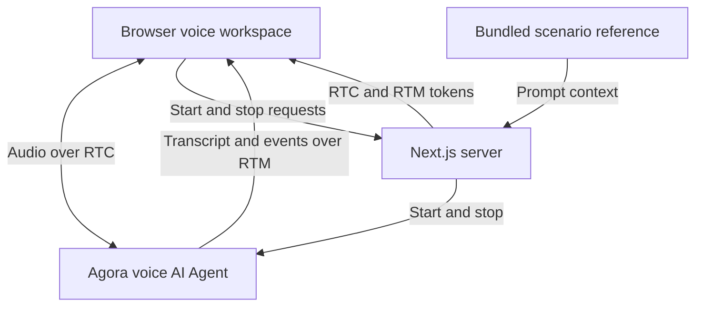

# Agora Mandarin Speaking Coach Demo

A Mandarin speaking coach demo built with Agora and Next.js. Practice short Chinese conversations with English guidance, written pinyin, and vocabulary or grammar feedback based on recognized text.

**[Explore more voice AI demos on Agora Recipes →](https://recipes.agora.io/)**

[](https://www.agora.io/en/products/conversational-ai-engine/)
[](https://nextjs.org/docs)
[](LICENSE)

[Features](#features) · [Tech stack](#tech-stack) · [Run locally](#run-locally) · [Deploy to Vercel](#deploy-to-vercel) · [How it works](#how-it-works) · [Customize](#customize) · [FAQ](#faq) · [More](#more)

<!-- Recipes URL: add the published Agora Recipes page URL here. -->
<!-- Video placement: add a linked cover image here once the actual demo video is ready. Show a beginner practicing a short Mandarin exchange, checking written pinyin, and receiving English expression feedback. Use a descriptive alt and public video URL. Verify playback or fallback links on GitHub and Recipes. -->

<a id="what-you-can-do"></a>

## Features

- **Everyday role-play:** practice introductions, restaurant ordering, and workplace conversations.
- **Choose your level:** practice beginner, intermediate, or advanced conversations with English explanations.
- **Written learning aids:** browse phrase cards with Chinese characters, tone-marked pinyin, and English meanings.
- **Expression feedback:** ask for a vocabulary or grammar correction, repetition, or a recap of what you practiced.
- **Voice and transcript:** hear the coach and review recognized conversation text.

## Tech Stack

- **Frontend:** Next.js, React, TypeScript.
- **Voice AI:** Agora Conversational AI, Agents SDK, RTC and RTM.
- **Models:** Deepgram STT, OpenAI LLM, MiniMax TTS.

<a id="quick-start"></a>
<a id="run-it"></a>
<a id="try-it"></a>
<a id="conversation"></a>

## Getting Started

### Run Locally

You need Node.js 24, pnpm 9.15.9, and an [Agora project](https://console.agora.io/) with Conversational AI enabled.

**1. Install and configure**

Clone or download this repository, then open a terminal in its directory.

```bash
pnpm install --frozen-lockfile

if [ ! -f .env.local ]; then
  cp env.local.example .env.local
fi
```

Create or select a project in [Agora Console](https://console.agora.io/). Open **Manage credentials** and copy its **App ID** and **Primary certificate** into `.env.local` ([instructions](https://docs.agora.io/en/introduction/console-setup)):

```dotenv
NEXT_PUBLIC_AGORA_APP_ID=your_agora_app_id
NEXT_AGORA_APP_CERTIFICATE=your_agora_app_certificate
```

You don’t need separate API keys for the default speech and language models. Put the App Certificate in `.env.local` and never expose it in browser code.

See [env.local.example](env.local.example) for the configuration template.

**2. Start the app**

```bash
pnpm run doctor
pnpm run dev
```

Open [http://localhost:3000](http://localhost:3000), choose **Practice Mandarin**, and allow microphone access. Ask the coach to summarize your practice if needed, then click the hang-up button (**End conversation**).

<a id="deployment"></a>

### Deploy to Vercel

[](https://vercel.com/new)

1. Import this repository into Vercel.
2. Select **Next.js** and Node.js 24.
3. Add `NEXT_PUBLIC_AGORA_APP_ID` and `NEXT_AGORA_APP_CERTIFICATE` under **Environment Variables**, then deploy.

## How It Works

1. **Start practicing:** Choose **Practice Mandarin** and allow microphone access.
2. **Choose a goal:** Tell the coach your level and the conversation you want to practice.
3. **Take turns:** Practice short Mandarin exchanges with English guidance and written phrase aids.
4. **Review your practice:** Ask for expression feedback, a recap, or a different exercise.

### Architecture



Next.js issues browser tokens and supplies the scenario instructions when starting the Agora Agent. Conversation behavior is prompt-driven; no live business system is connected. See [ARCHITECTURE.md](ARCHITECTURE.md) for details.

<a id="faq-and-limitations"></a>

## FAQ

### Do I need separate model API keys?

Not for the default configuration. The demo uses Agora-managed model access.

### How do I choose a topic or difficulty?

Tell the coach your level and what you want to practice. Try “I am a beginner. Help me introduce myself in Mandarin.” Selecting phrase cards does not change the conversation topic; ask the coach directly.

### Why does the coach keep explaining things in English?

English guidance is the default at every level. Ask explicitly for Mandarin-only practice if you want immersion, or ask for English if you get stuck. A request for harder practice changes the phrases, not the guidance language.

### Can it tell whether I pronounced a word correctly?

Feedback uses recognized text, not acoustic pronunciation or tone assessment. The coach can model a phrase and help with vocabulary or grammar, but it cannot certify that your pronunciation was correct.

### Why can’t I start a voice session?

Check browser microphone permission, the selected input device, and your Agora App ID, App Certificate, and Conversational AI access. Use localhost or HTTPS. Run `pnpm run doctor` for local configuration checks, then use the page’s error message to guide a retry.

### Can I save a copy of the conversation?

Yes. Open Inspector and select **Export session evidence** to download the current or latest call as JSON. Export it before starting another call or refreshing the page.

<a id="customize"></a>

### How do I make this demo more realistic?

Connect your own knowledge base and business services using [RAG](https://docs.agora.io/en/ai/build/custom-model-integration/custom-llm), [tool calling](https://docs.agora.io/en/ai/build/tools/custom-tools), or [MCP](https://docs.agora.io/en/ai/build/tools/mcp-tools). When adding tools, set `advancedFeatures.enable_tools` to `true` in [Agent setup](app/api/invite-agent/route.ts).

### How do I adapt this demo to my own use case?

Customize the agent’s prompt, business tools, and interface for your scenario.

## License and Attribution

Licensed under the [MIT License](LICENSE). Retain the [third-party notices](THIRD_PARTY_NOTICES.md).

## More

- **[Recipes](https://recipes.agora.io/):** Explore more Agora demos and integrations.
- **[Docs](https://docs.agora.io/en/ai):** Learn how to build and extend voice agents.
- **[Console](https://console.agora.io/):** Create projects and manage credentials and usage.
