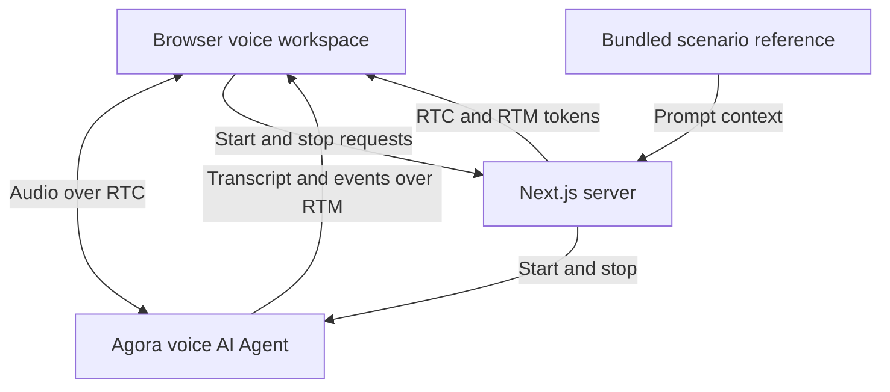

# Agora Multilingual Speaking Coach Demo

[English](README.md) | [简体中文](README.zh-CN.md) | [日本語](README.ja.md)

Practice Spanish, French, German, Portuguese, Japanese or Korean with English instructions, explanations and feedback. Ask explicitly for immersion in the selected language.

**[Try the live demo →](https://agora-speaking-coach-demo.vercel.app)**

**[Explore more voice AI demos on Agora Recipes →](https://recipes.agora.io/)**

[](https://www.agora.io/en/products/conversational-ai-engine/)
[](https://nextjs.org/docs)
[](LICENSE)

[Features](#features) · [Tech stack](#tech-stack) · [Run locally](#run-locally) · [Deploy to Vercel](#deploy-to-vercel) · [How it works](#how-it-works) · [Customize](#customize) · [FAQ](#faq) · [More](#more)

<a id="what-you-can-do"></a>
<a id="features"></a>

## Features

- Choose a language and a lesson from a beginner curriculum: introductions, a workplace conversation, ordering a meal and asking for the check.
- Practice toward the lesson’s can-do objective with English guidance; the coach receives only the selected lesson.
- For the introduction lesson, optionally type a first name or nickname: the lesson phrases on the page show it as you type, and the coach teaches the introduction with it.
- Read the lesson’s vocabulary, usage point and model dialogue in the Phrasebook, with romanized reading aids for Japanese and Korean.
- Receive vocabulary or grammar feedback based on recognized text.
- See a practice summary after the session and mark the lesson complete.
- Pick up where you left off: practice history is saved without an account, with a learner code for switching devices.

Lesson objectives are original can-do statements written in the style of level A1 of the Council of Europe’s [Common European Framework of Reference for Languages (CEFR)](https://www.coe.int/en/web/common-european-framework-reference-languages). The framework organizes the lessons only; the coach does not assess or certify a learner’s level.

## Tech Stack

- **Frontend:** Next.js, React, TypeScript.
- **Voice AI:** Agora Conversational AI, Agents SDK, RTC and RTM.
- **Models:** Agora ARES STT, OpenAI LLM, MiniMax TTS.

<a id="quick-start"></a>
<a id="run-it"></a>
<a id="try-it"></a>
<a id="conversation"></a>

## Getting Started

### Create with npm

Use Node.js 24 to create a complete editable project:

```bash
npx agora-speaking-coach-demo@latest my-app
cd my-app
```

Then follow the installation and configuration steps below. The destination must be new or empty; the creator does not install dependencies or configure credentials. `@latest` uses the latest published version, which may differ from this repository. Maintainers: see [npm releases and Vercel automation](https://github.com/AgoraIO-Community/agora-speaking-coach-demo/blob/main/docs/npm-release.md).

### Run Locally

You need Node.js 24, pnpm 9.15.9, and an [Agora project](https://console.agora.io/) with Conversational AI enabled.

**1. Install and configure**

Clone or download this repository, then open a terminal in its directory.

```bash
pnpm install --frozen-lockfile

if [ ! -f .env.local ]; then
  cp env.local.example .env.local
fi
```

Create or select a project in [Agora Console](https://console.agora.io/). Open **Manage credentials** and copy its **App ID** and **Primary certificate** into `.env.local` ([instructions](https://docs.agora.io/en/introduction/console-setup)):

```dotenv
NEXT_PUBLIC_AGORA_APP_ID=your_agora_app_id
NEXT_AGORA_APP_CERTIFICATE=your_agora_app_certificate
```

You don’t need separate API keys for the default speech and language models. Put the App Certificate in `.env.local` and never expose it in browser code.

See [env.local.example](env.local.example) for the configuration template.

Speech recognition uses Agora ARES, managed by Agora with no vendor key. Each session listens for English plus the selected practice language (for example `en-US,es-ES`) and sends the selected lesson's phrases, with your practice name where the lesson uses one, as recognition keywords. This replaced Deepgram nova-3 `multi` after an automated test with synthetic voices: for "Hola.", "Me llamo \<name\>." (the lesson's "My name is" phrase with a practice name) and "Vivo en Boston." ARES returned the exact text in 102 of 102 turns and Deepgram `multi` in 47 of 210, where "Me llamo \<name\>." came back as words such as "Mediano ..." every time; English was recognized with both. Keywords nudge the recognizer toward the lesson phrases, so the transcript can show the expected phrase when you were only close to it, and recognized text is never a pronunciation assessment. A real accented learner was not measured, so your own session is the final test. Server-only variables: `COACH_STT_VENDOR=deepgram` returns to Deepgram `multi`, and `COACH_STT_KEYWORDS=off` stops sending keywords. `COACH_STT_LANGUAGE_HINT` and `COACH_STT_ENDPOINTING` apply to the Deepgram fallback only; the list form of the hint (`on`) returned empty text for every learner turn in testing and should not be used. See [architecture](ARCHITECTURE.md#speech-configuration) for the measurements.

### Saved progress (optional settings)

Practice history is saved with no extra setup: lessons practiced or marked complete, session dates and turn counts, per anonymous browser. **Saved progress** on the start page shows a learner code for continuing on another device and a reset action.

| Variable | Default | Purpose |
|---|---|---|
| `PROGRESS_STORE` | `file` | `file` (JSON file), `sqlite` (database file) or `postgres` (Neon or Supabase). File and SQLite need a persistent disk; use `postgres` on serverless hosts such as Vercel. |
| `PROGRESS_DATA_DIR` | `.scenario-data` | Directory for the file and SQLite stores. In Docker, mount a volume at `/app/.scenario-data`. |
| `DATABASE_URL` | unset | Connection string for `postgres`. Not verified against a live database in this repository's checks. |
| `COACH_PUBLIC_BASE_URL` | unset | This app's public address (hosted, or a tunnel such as ngrok). When set, the coach records corrections and the lesson result itself. Unset: the browser reports sessions and you mark lessons complete. |
| `AGORA_WEBHOOK_SECRET` | unset | With `COACH_PUBLIC_BASE_URL`, logs the text of each finished conversation from Agora's webhook at `<url>/api/agora-webhook`. Unset: conversations are not stored. |

Conversation logging also needs a webhook on your Agora project for the agent history event, for example `agora project webhook create --feature convoai --url <url>/api/agora-webhook --events agent-memory`. `pnpm run doctor` reports which of these modes are configured. See [architecture](ARCHITECTURE.md#saved-progress-and-conversation-logging) for the data model, retention and limits.

**2. Start the app**

```bash
pnpm run doctor
pnpm run dev
```

Open [http://localhost:3000](http://localhost:3000), select a practice language, choose **Start practice**, and allow microphone access. Ask the coach to summarize your practice if needed, then click the hang-up button (**End conversation**).

Each session ends automatically after 10 minutes; choose Start again to continue.

<a id="deployment"></a>

### Deploy to Vercel

[](https://vercel.com/new/clone?repository-url=https%3A%2F%2Fgithub.com%2FAgoraIO-Community%2Fagora-speaking-coach-demo&env=NEXT_PUBLIC_AGORA_APP_ID%2CNEXT_AGORA_APP_CERTIFICATE&envDescription=Agora%20App%20ID%20and%20App%20Certificate%20from%20Agora%20Console.%20Enable%20Conversational%20AI%20for%20the%20project.&envLink=https%3A%2F%2Fdocs.agora.io%2Fen%2Fintroduction%2Fconsole-setup&project-name=agora-speaking-coach-demo&repository-name=agora-speaking-coach-demo)

1. Click the button to clone this repository into your Git account and import it into Vercel.
2. Select **Next.js** and Node.js 24.
3. Add `NEXT_PUBLIC_AGORA_APP_ID` and `NEXT_AGORA_APP_CERTIFICATE` under **Environment Variables**, then deploy.

The maintained Community demo uses GitHub Actions for production deployment after verification. README/documentation-only updates do not deploy; application, asset, dependency and build configuration changes on `main` do. See [maintainer deployment setup](https://github.com/AgoraIO-Community/agora-speaking-coach-demo/blob/main/docs/npm-release.md#production-website-deployment-with-github-actions) for credentials, path filters and manual deployment. The production workflow runs only in the Community repository.

## How It Works

1. Select Spanish, French, German, Portuguese, Japanese or Korean and a lesson, then choose **Start practice** and allow microphone access.
2. Try: “Yes, I’m ready. Please go slowly.”
3. Practice toward the lesson’s can-do objective with English guidance.
4. Receive vocabulary or grammar feedback based on recognized text, then review the practice summary when the session ends.

### Architecture



Next.js issues browser tokens and supplies the scenario instructions when starting the Agora Agent. Conversation behavior is prompt-driven; no live business system is connected. See [ARCHITECTURE.md](ARCHITECTURE.md) for details.

<a id="faq-and-limitations"></a>

## FAQ

### What should I say?

Yes, I’m ready. Please go slowly.

### What is available?

Choose a language and a lesson from a beginner curriculum: introductions, a workplace conversation, ordering a meal and asking for the check. Practice toward the lesson’s can-do objective with English guidance. Read the lesson’s vocabulary, usage point and model dialogue in the Phrasebook, with romanized reading aids for Japanese and Korean. Receive vocabulary or grammar feedback based on recognized text. See a practice summary after the session and pick up where you left off: practice history is saved without an account.

### What remains simulated?

Practice uses recognized text. No pronunciation scoring or certified proficiency is provided; saved progress is practice history, not a grade. English guidance remains default unless immersion in the selected language is requested.

### Why can’t I start a voice session?

Check browser microphone permission, the selected input device, and your Agora App ID, App Certificate, and Conversational AI access. Use localhost or HTTPS. Run `pnpm run doctor` for local configuration checks, then use the page’s error message to guide a retry.

### Can I save a copy of the conversation?

Yes. Open Inspector and select **Export session evidence** to download the current or latest call as JSON. Export it before starting another call or refreshing the page.

### Are my conversations saved?

Audio is never saved by this app. Conversation text is stored only when the deployment sets `COACH_PUBLIC_BASE_URL` and `AGORA_WEBHOOK_SECRET` and its Agora project delivers the agent history webhook; **Saved progress** shows whether logging is on. Stored conversations (the newest 20, up to 90 days) are deleted when you reset your progress. Live webhook delivery has not been verified in this repository.

The optional practice name for the introduction lesson is sent only with the session start request (`learner_name`) and is used for that session’s instructions and greeting. It is not stored as a field in saved progress. Like anything else said in the call, it is part of the conversation text when logging is on.

<a id="customize"></a>

### How do I make this demo more realistic?

Connect your own knowledge base and business services using [RAG](https://docs.agora.io/en/ai/build/custom-model-integration/custom-llm), [tool calling](https://docs.agora.io/en/ai/build/tools/custom-tools), or [MCP](https://docs.agora.io/en/ai/build/tools/mcp-tools). When adding tools, set `advancedFeatures.enable_tools` to `true` in [Agent setup](app/api/invite-agent/route.ts).

### How do I adapt this demo to my own use case?

Customize the agent’s prompt, business tools, and interface for your scenario.

## License and Attribution

Licensed under the [MIT License](LICENSE). Retain the [third-party notices](THIRD_PARTY_NOTICES.md).

## More

- **[Recipes](https://recipes.agora.io/):** Explore more Agora demos and integrations.
- **[Docs](https://docs.agora.io/en/ai):** Learn how to build and extend voice agents.
- **[Console](https://console.agora.io/):** Create projects and manage credentials and usage.
