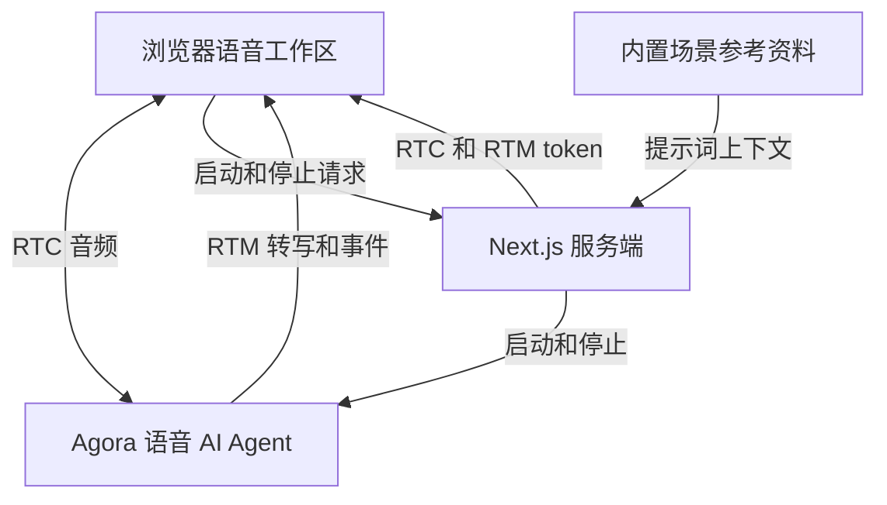

# Agora 多语言口语教练演示

[English](README.md) | [简体中文](README.zh-CN.md) | [日本語](README.ja.md)

本文仅翻译文档；应用界面使用英语。支持西班牙语、法语、德语、葡萄牙语、日语和韩语，默认用英语引导。

以英语提供引导和反馈，用所选语言练习自我介绍、点餐和职场交流。

**[在线体验 →](https://agora-speaking-coach-demo.vercel.app)**

**[Explore more voice AI demos on Agora Recipes →](https://recipes.agora.io/)**

[](https://www.agora.io/en/products/conversational-ai-engine/)
[](https://nextjs.org/docs)
[](LICENSE)

[功能](#features) · [技术栈](#tech-stack) · [本地运行](#run-locally) · [部署到 Vercel](#deploy-to-vercel) · [使用流程](#how-it-works) · [定制](#customize) · [常见问题](#faq) · [更多](#more)

<a id="what-you-can-do"></a>
<a id="features"></a>

## 功能

- 选择语言和初级课程中的一课：自我介绍、职场对话、点餐和结账。
- 围绕该课的 can-do 目标练习，默认用英语引导；教练只会收到所选课程的内容。
- 在自我介绍一课中，可选填一个名字或昵称：页面上的课程短语会随输入实时显示该名字，教练也会用它来教你做自我介绍。
- Phrasebook 展示该课的词汇、用法要点和示范对话；日语和韩语附罗马字读音。
- 基于转写文本获得词汇和语法反馈。
- 会话结束后查看练习小结，并标记课程完成。
- 从上次中断处继续：无需账号即可保存练习记录，并提供学习码用于切换设备。

课程目标是参照欧洲委员会[《欧洲语言共同参考框架》(CEFR)](https://www.coe.int/en/web/common-european-framework-reference-languages) A1 级风格原创编写的 can-do 陈述。该框架仅用于组织课程；教练不评估或认证学习者的水平。
- 基于转写文本纠正词汇和语法；不评分发音。

## 技术栈

- **前端：**  Next.js、React、TypeScript。
- **语音 AI：**  Agora Conversational AI、Agents SDK、RTC、RTM。
- **模型：**  Agora ARES STT、OpenAI LLM、MiniMax TTS。

<a id="quick-start"></a>

<a id="run-it"></a>

<a id="try-it"></a>

<a id="conversation"></a>

## 快速开始

<a id="run-locally"></a>

### 使用 npm 创建项目

使用 Node.js 24 创建完整、可编辑的项目：

```bash
npx agora-speaking-coach-demo@latest my-app
cd my-app
```

然后按照下方步骤安装依赖并配置凭据。目标目录必须不存在或为空；生成器不会安装依赖或配置凭据。`@latest` 使用 npm 最新已发布版本，可能与仓库不同。维护者请参阅 [npm 发布与 Vercel 自动化说明（英文）](https://github.com/AgoraIO-Community/agora-speaking-coach-demo/blob/main/docs/npm-release.md)。

### 本地运行

需要 Node.js 24、pnpm 9.15.9，以及已启用 Conversational AI 的 [Agora 项目](https://console.agora.io/)。

**1. 安装与配置**

克隆或下载本仓库，然后在仓库目录中打开终端。

```bash
pnpm install --frozen-lockfile

if [ ! -f .env.local ]; then
  cp env.local.example .env.local
fi
```

在 [Agora Console](https://console.agora.io/) 创建或选择项目。打开 **Manage credentials**，将 **App ID** 和 **Primary certificate** 复制到 `.env.local`（[操作说明](https://docs.agora.io/en/introduction/console-setup)）：

```dotenv
NEXT_PUBLIC_AGORA_APP_ID=your_agora_app_id
NEXT_AGORA_APP_CERTIFICATE=your_agora_app_certificate
```

默认语音和语言模型无需单独配置 API Key。App Certificate 仅限服务端使用，请保存在 `.env.local`，不要暴露在浏览器代码中。配置模板见 [env.local.example](env.local.example)。

语音识别使用 Agora ARES，由 Agora 托管，无需供应商密钥。每次会话同时识别英语和所选的练习语言（例如 `en-US,es-ES`），并把所选课程的短语（课程用到练习名字时也包含该名字）作为识别关键词发送。这一默认设置是在用合成语音做自动化测试后取代 Deepgram nova-3 `multi` 的：对于“Hola.”“Me llamo \<name\>.”（课程中“我的名字是”这一短语加上练习名字）和“Vivo en Boston.”，ARES 在 102 轮中有 102 轮返回完全一致的文本，Deepgram `multi` 在 210 轮中只有 47 轮，其中“Me llamo \<name\>.”每次都被识别成“Mediano ...”之类的词；两者都能正确识别英语。关键词会让识别器偏向课程短语，因此当你只是说得接近时，对话记录也可能显示预期的短语；识别出的文本绝不代表发音评估。测试没有覆盖带口音的真人学习者，所以最终仍要以你自己的会话为准。仅限服务端的变量：`COACH_STT_VENDOR=deepgram` 可切换回 Deepgram `multi`，`COACH_STT_KEYWORDS=off` 可停止发送关键词。`COACH_STT_LANGUAGE_HINT` 和 `COACH_STT_ENDPOINTING` 只对 Deepgram 备用方案生效；提示的列表形式（`on`）在测试中让学习者每一轮的识别文本都为空，请勿使用。测量结果详见[架构说明](ARCHITECTURE.md#speech-configuration)。

### 保存进度（可选设置）

无需额外配置即可保存练习记录：练习过或标记完成的课程、会话日期和发言次数，按匿名浏览器保存。首页的 **Saved progress** 会显示学习码，可用于在其他设备上继续，也可重置进度。

| 变量 | 默认值 | 用途 |
|---|---|---|
| `PROGRESS_STORE` | `file` | `file`（JSON 文件）、`sqlite`（数据库文件）或 `postgres`（Neon 或 Supabase）。文件和 SQLite 需要持久磁盘；在 Vercel 等无服务器环境请使用 `postgres`。 |
| `PROGRESS_DATA_DIR` | `.scenario-data` | 文件和 SQLite 存储所在目录。Docker 中请将卷挂载到 `/app/.scenario-data`。 |
| `DATABASE_URL` | 未设置 | `postgres` 的连接串。本仓库的检查未在真实数据库上验证。 |
| `COACH_PUBLIC_BASE_URL` | 未设置 | 本应用的公网地址（托管部署，或 ngrok 等隧道）。设置后由教练记录纠正和课程结果；未设置时由浏览器上报会话，由你标记课程完成。 |
| `AGORA_WEBHOOK_SECRET` | 未设置 | 与 `COACH_PUBLIC_BASE_URL` 同时设置时，通过 Agora webhook（`<url>/api/agora-webhook`）记录每次结束对话的文本。未设置则不保存对话。 |

对话记录还需要在 Agora 项目上为 agent history 事件配置 webhook，例如 `agora project webhook create --feature convoai --url <url>/api/agora-webhook --events agent-memory`。`pnpm run doctor` 会报告已配置的模式。数据模型、保留期限和限制见 [architecture](ARCHITECTURE.md#saved-progress-and-conversation-logging)。

**2. 启动应用**

```bash
pnpm run doctor
pnpm run dev
```

打开 [http://localhost:3000](http://localhost:3000)，选择西班牙语、法语、德语、葡萄牙语、日语或韩语，再点击 **Start practice** 并允许使用麦克风。需要时可请助手总结对话，点击挂断按钮（**End conversation**）结束。

每次会话满 10 分钟自动结束，点击 Start again 可重新开始。

<a id="deployment"></a>

<a id="deploy-to-vercel"></a>

### 部署到 Vercel

[](https://vercel.com/new/clone?repository-url=https%3A%2F%2Fgithub.com%2FAgoraIO-Community%2Fagora-speaking-coach-demo&env=NEXT_PUBLIC_AGORA_APP_ID%2CNEXT_AGORA_APP_CERTIFICATE&envDescription=Agora%20App%20ID%20and%20App%20Certificate%20from%20Agora%20Console.%20Enable%20Conversational%20AI%20for%20the%20project.&envLink=https%3A%2F%2Fdocs.agora.io%2Fen%2Fintroduction%2Fconsole-setup&project-name=agora-speaking-coach-demo&repository-name=agora-speaking-coach-demo)

1. 点击按钮，将本仓库克隆到你的 Git 账户并导入 Vercel。
2. 选择 **Next.js** 和 Node.js 24。
3. 在 **Environment Variables** 中填写 `NEXT_PUBLIC_AGORA_APP_ID` 和 `NEXT_AGORA_APP_CERTIFICATE`，然后部署。

Community 官方演示站通过 GitHub Actions 在验证通过后部署生产环境。仅修改 README 或文档不会部署；`main` 上的应用、静态资源、依赖和构建配置变更会触发部署。凭据、路径过滤和手动部署详见[维护者部署说明（英文）](https://github.com/AgoraIO-Community/agora-speaking-coach-demo/blob/main/docs/npm-release.md#production-website-deployment-with-github-actions)。生产部署 workflow 仅在 Community 仓库运行。

<a id="how-it-works"></a>

## 使用流程

1. 选择西班牙语、法语、德语、葡萄牙语、日语或韩语并选择一课，再点击 **Start practice** 并允许麦克风访问。
2. 试说：“Yes, I’m ready. Please go slowly.”
3. 围绕该课的 can-do 目标练习，默认用英语引导。
4. 基于转写文本纠正词汇和语法，会话结束后查看练习小结；不评分发音。

### 架构



Next.js 签发浏览器 token，并在启动 Agora Agent 时提供场景指令。对话行为由提示词驱动，未连接实时业务系统。详见 [ARCHITECTURE.md](ARCHITECTURE.md)。

<a id="faq-and-limitations"></a>

<a id="faq"></a>

## 常见问题

### 可以尝试什么？

Yes, I’m ready. Please go slowly.

### 能力范围是什么？

选择语言和初级课程中的一课：自我介绍、职场对话、点餐和结账。 围绕该课的 can-do 目标练习，默认用英语引导。 Phrasebook 展示该课的词汇、用法要点和示范对话；日语和韩语附罗马字读音。 基于转写文本纠正词汇和语法；不评分发音。 会话结束后可查看练习小结，并从上次中断处继续：练习记录无需账号即可保存。

### 哪些内容不会实际执行？

所有业务资料均为虚构示例。除练习记录外，结果仅用于当前对话，不写入外部系统，也不通知他人。口语教练不提供发音评分；保存的进度是练习记录，不是成绩。

### 为什么无法启动语音会话？

检查浏览器麦克风权限、输入设备、Agora App ID、App Certificate 和 Conversational AI 权限。请使用 localhost 或 HTTPS。运行 `pnpm run doctor` 检查本地配置，再按页面错误提示重试。

### 可以保存对话副本吗？

可以。在 Inspector 中选择 **Export session evidence**，将当前或最近一次通话下载为 JSON。请在开始新通话或刷新页面前导出。

### 我的对话会被保存吗？

本应用从不保存音频。只有部署方同时设置了 `COACH_PUBLIC_BASE_URL` 和 `AGORA_WEBHOOK_SECRET`，并且其 Agora 项目投递 agent history webhook 时，才会保存对话文本；**Saved progress** 会显示记录是否开启。已保存的对话（最新 20 条，最长 90 天）会在你重置进度时删除。本仓库尚未验证真实的 webhook 投递。

自我介绍一课中可选填的练习用名字只随会话启动请求（`learner_name`）发送，并仅用于该次会话的指令和开场白。它不会作为字段保存到进度中。与通话中说出的其他内容一样，在对话记录开启时，它会出现在对话文本里。

<a id="customize"></a>

### 如何让演示更贴近真实业务？

通过 [RAG](https://docs.agora.io/en/ai/build/custom-model-integration/custom-llm)、[工具调用](https://docs.agora.io/en/ai/build/tools/custom-tools)或 [MCP](https://docs.agora.io/en/ai/build/tools/mcp-tools) 连接自己的知识库和业务服务。 添加工具时，在 [Agent 配置](app/api/invite-agent/route.ts)中将 `advancedFeatures.enable_tools` 设为 `true`。

### 如何适配自己的场景？

按你的场景定制 Agent 提示词、业务工具和界面。

## 许可与来源

采用 [MIT License](LICENSE)。请保留[第三方声明](THIRD_PARTY_NOTICES.md)。

<a id="more"></a>

## 更多

- **[Recipes](https://recipes.agora.io/)：** 探索更多 Agora 演示与集成。
- **[Docs](https://docs.agora.io/en/ai)：** 学习构建和扩展语音 Agent。
- **[Console](https://console.agora.io/)：** 创建项目，管理凭据和用量。
